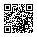

# Varlık Takip

**Varlık Takip**, kişi bazında sahip olduğunuz varlıkları ve bu varlıkların saklandığı yerleri düzenli şekilde takip etmenize yardımcı olan bir iOS uygulamasıdır.

## 📱 Uygulamayı indirin

Varlık Takip özellikleri ve örnek ekranları: **[Uygulamanın tanıtım sayfası](https://gururorkun.github.io/varlik-takip/)**.

Varlık Takip; varlık geçmişi, yenilenmiş ekranlar, isteğe bağlı Apple girişi ve özel iCloud çalışma alanı paylaşımı sunar. Yerel kayıtlar Apple ile giriş yapıldığında otomatik olarak buluta taşınmaz.

Tanıtım, destek ve gizlilik sayfaları bu geliştirici sitesinde yayımlanır.

Varlık Takip artık App Store'da yayınlandı.

**[App Store'da Varlık Takip'i aç](https://apps.apple.com/app/id6814716446)**

QR kodu iPhone kamerasıyla tarayarak da uygulama sayfasına ulaşabilirsiniz:

  

## ✨ Öne çıkan özellikler

- 👤 Birden fazla kişi için ayrı varlık takibi
- 💰 Para, altın, menkul kıymet ve diğer varlık türleri
- 🏦 Banka / aracı kurum bilgileri
- 📱 Dijital platform ve fiziksel saklama yeri takibi
- 📊 Toplam varlık görünümü
- 📈 Varlık analizi
- 🕒 İşlem tarihçesi
- 🔎 Filtreleme ve arama
- 🔐 Yerel çalışma alanı hesap açmadan kullanılır

## 📋 Uygulama hakkında

Varlık Takip ile farklı kişilerin varlıklarını tek bir yerde kayıt altında tutabilir, aynı varlığın farklı kişilerdeki toplamını görebilir ve varlıkların saklama yerlerini takip edebilirsiniz.

Uygulama banka hesabına bağlanmaz; yatırım tavsiyesi, anlık işlem fiyatı, gerçek yatırım işlemi veya para transferi sunmaz.

## 1.2 için hazırlanan yenilikler

Bu özellikler geliştirme sürümünde doğrulanan kaynakta bulunur; App Store'da 1.2 henüz yayımlanmadı.

- Desteklenen döviz ve altın için referans kurlarla tahmini TL değerleri.
- Pozitif, fiyatlandırılabilen TL, döviz ve altın kayıtları için dağılım grafiği.
- Referans kur kaynakları, tarihleri ve son kontrol bilgileri.
- Kişisel ve birden fazla paylaşılan iCloud çalışma alanı arasında geçiş.

Menkul kıymetler, diğer varlıklar ve fiyatı bulunamayan kayıtlar tahmini toplama dahil edilmez. Referans değerler yaklaşık ve bilgilendirme amaçlıdır; bağlantı veya kaynak kullanılamadığında son kayıtlı kurlar gösterilebilir.

Güncel geliştirme arayüzünün anonim gerçek ekran görüntüleri henüz bu sayfaya eklenmemiştir.

## 🔒 Gizlilik

[Varlık Takip Gizlilik Politikası](https://gururorkun.github.io/varlik-takip/privacy.html)

## 💬 Destek ve geri bildirim

[Varlık Takip Destek Sayfası](https://gururorkun.github.io/varlik-takip/support.html)

**E-posta:** g.o.urensel@hotmail.com

---

© 2026 Gurur Orkun Ürensel

